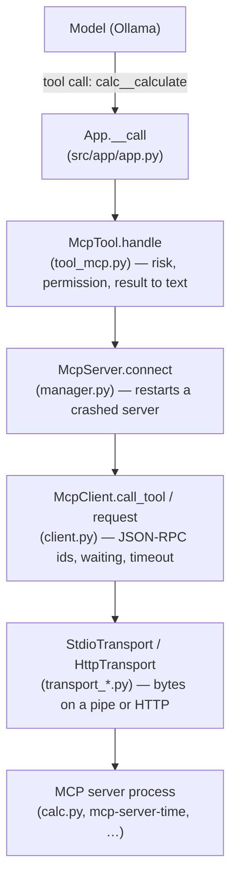
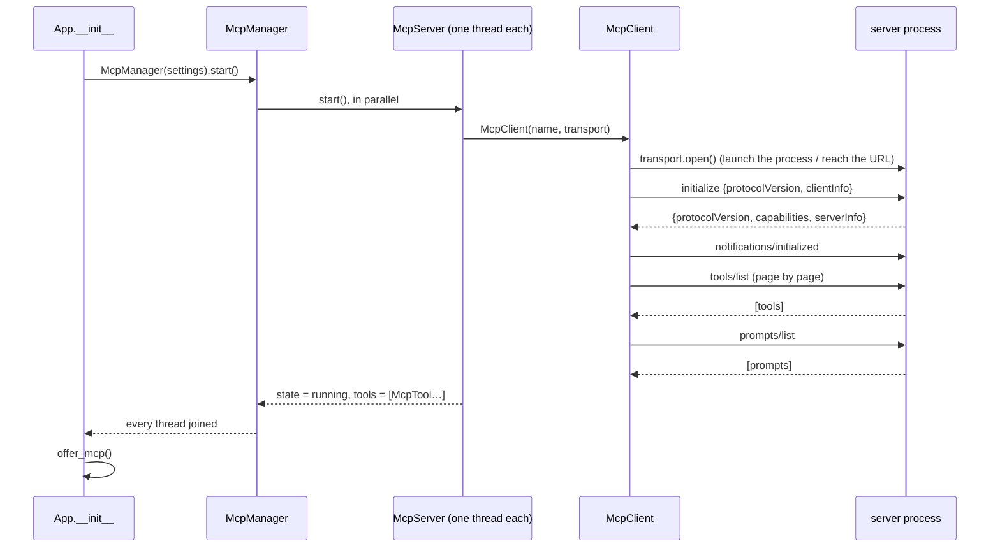
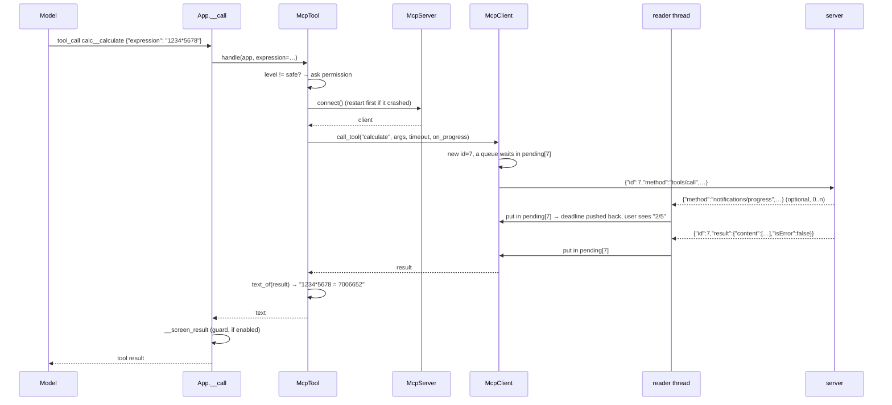
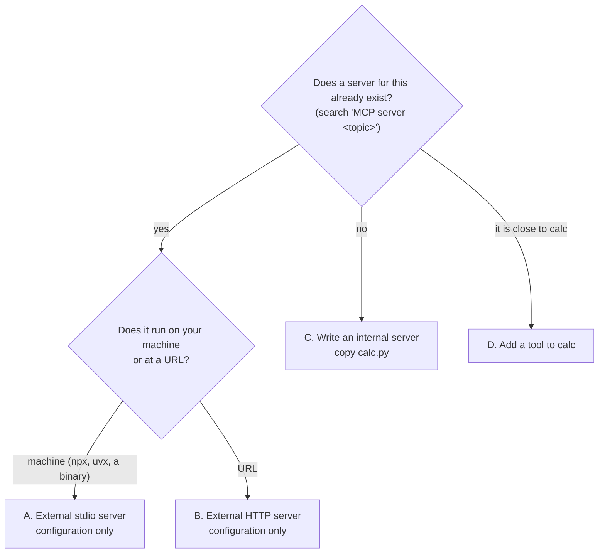

# MCP in Louis: a guide

This guide explains **what MCP is**, **why it is useful**, **how it works inside Louis**, and **how to add a new MCP
server**. Every part links to the code that does it, so you can open the file at the right line and read along.

> Companion documents: [`docs/MCP.md`](MCP.md) is the project report (requirements, commits, tests, every edge case,
> in French). The README section [« Serveurs MCP »](../README.md#serveurs-mcp) is the short user manual. This guide is
> the one to read first.
>
> Line numbers drift as the code changes. Each link also names the function or class, so if a line moved, search for
> the name.

## Contents

1. [TL;DR](#1-tldr)
2. [What is MCP?](#2-what-is-mcp)
3. [Why is it useful?](#3-why-is-it-useful)
4. [The vocabulary, mapped to our code](#4-the-vocabulary-mapped-to-our-code)
5. [How it works, step by step](#5-how-it-works-step-by-step)
6. [Our servers: `calc` (internal) and `time` (external)](#6-our-servers-calc-internal-and-time-external)
7. [How to add a new MCP server](#7-how-to-add-a-new-mcp-server)
8. [Safety: risk, permissions and trust](#8-safety-risk-permissions-and-trust)
9. [Troubleshooting](#9-troubleshooting)
10. [Limits and open questions](#10-limits-and-open-questions)
11. [Further reading](#11-further-reading)

---

## 1. TL;DR

- **MCP** (Model Context Protocol) is a standard way for an AI application to use tools that live **in another
  program**. That program is an **MCP server**. The AI application is the **MCP client**.
- **Louis is an MCP client.** At startup it launches every declared server, asks each one "which tools do you have?",
  and gives those tools to the model next to its own (`cat_file`, `git`…), named `<server>__<tool>`
  (`calc__calculate`).
- When the model calls one of these tools, Louis forwards the call to the server, gets the result back, and hands it to
  the model. **The model never knows the tool came from somewhere else.**
- Servers are declared in [`settings.py`](../src/config/settings.py#L96) or in a `.mcp.json` file (same format as
  Claude Code). **Adding one is configuration, not code**, unless you write the server yourself.
- We declare two today: **`calc`** (ours, [`servers/calc.py`](../src/tool/mcp/servers/calc.py)) and **`time`**
  (someone else's, `mcp-server-time` from PyPI). Louis can also *be* a server: `louis --mcp-server`.
- All the client code is in [`src/tool/mcp/`](../src/tool/mcp/), about 1,500 lines of standard-library Python.

---

## 2. What is MCP?

### The problem it solves

A language model on its own can only produce text. To *do* things (read a file, check the time, search GitHub) the
application around it offers it **tools**: a name, a description, and a JSON schema of the arguments. The model
answers with "call `X` with these arguments", the application runs it, and gives the result back to the model.

Before MCP, every application wrote its own tools, in its own code, and nobody could reuse them. A GitHub tool written
for one assistant had to be rewritten for the next.

**MCP is a protocol that moves tools out of the application into separate programs.** Any application that speaks MCP
can use any server that speaks MCP. A common comparison is USB: a device made once works in any computer that has the
port.

### The three roles

| Role | What it is | In Louis |
| --- | --- | --- |
| **Host** | The AI application the user talks to. It owns the model and the conversation. | Louis itself: [`App`](../src/app/app.py#L100) |
| **Client** | The part of the host that holds **one connection to one server**. One client per server. | [`McpClient`](../src/tool/mcp/client.py#L48) |
| **Server** | A separate program (or a URL) that offers tools and/or prompts. It knows nothing about the model. | [`calc.py`](../src/tool/mcp/servers/calc.py), `mcp-server-time`, … |

### What a server can offer

| Primitive | Who uses it | Example | Supported by Louis? |
| --- | --- | --- | --- |
| **Tools** | The **model** decides to call them | `calc__calculate {"expression": "2+2"}` | Yes |
| **Prompts** | The **user** runs them, as ready-made messages | `/calc:explain (3+4)*sqrt(16)` | Yes, as `/<server>:<prompt>` commands |
| **Resources** | The application reads them as context (files, records) | `file:///notes/todo.md` | No (see [Limits](#10-limits-and-open-questions)) |

### What travels on the wire: JSON-RPC 2.0

Client and server exchange small JSON messages. There are three kinds:

- a **request** has an `id`, a `method` and `params`, and expects an answer;
- a **response** carries the same `id`, with a `result` **or** an `error`;
- a **notification** has a `method` but **no `id`**: nobody answers it.

There are two ways to carry these messages (the **transport**):

- **stdio**: the client launches the server as a child process. One JSON message per line on the server's standard
  input (client → server) and standard output (server → client). Its standard error is free for logs.
- **Streamable HTTP**: the server runs elsewhere; each message is a `POST` to its URL.

### A real conversation with `calc`

You can have this conversation yourself, without Louis. Paste this in a terminal at the root of the project:

```bash
printf '%s\n' \
  '{"jsonrpc":"2.0","id":1,"method":"initialize","params":{"protocolVersion":"2025-06-18","capabilities":{},"clientInfo":{"name":"me","version":"0"}}}' \
  '{"jsonrpc":"2.0","method":"notifications/initialized"}' \
  '{"jsonrpc":"2.0","id":2,"method":"tools/list"}' \
  '{"jsonrpc":"2.0","id":3,"method":"tools/call","params":{"name":"calculate","arguments":{"expression":"1234*5678"}}}' \
  '{"jsonrpc":"2.0","id":4,"method":"tools/call","params":{"name":"calculate","arguments":{"expression":"1/0"}}}' \
| venv/bin/python src/tool/mcp/servers/calc.py
```

What `calc` answers (descriptions shortened):

```jsonc
// 1. initialize: "here is my protocol version, and what I can do: tools and prompts"
{"jsonrpc":"2.0","id":1,"result":{"protocolVersion":"2025-06-18","capabilities":{"tools":{},"prompts":{}},
  "serverInfo":{"name":"calc","title":"Calculatrice de Louis","version":"1.0"}}}
// (notifications/initialized got no answer: it is a notification)
// 2. tools/list: one tool, its description for the model, the JSON schema of its arguments, and hints about its risk
{"jsonrpc":"2.0","id":2,"result":{"tools":[{"name":"calculate","description":"Calcule exactement une expression…",
  "inputSchema":{"type":"object","properties":{"expression":{"type":"string"}},"required":["expression"]},
  "annotations":{"readOnlyHint":true,"openWorldHint":false}}]}}
// 3. tools/call: the result is a list of content parts, plus isError
{"jsonrpc":"2.0","id":3,"result":{"content":[{"type":"text","text":"1234*5678 = 7006652"}],"isError":false}}
// 4. A failed calculation is still a *result*, flagged isError: the model reads it and can react
{"jsonrpc":"2.0","id":4,"result":{"content":[{"type":"text","text":"Calcul impossible : division par zéro."}],"isError":true}}
```

That is all MCP is at its core: **a handshake (`initialize`), a listing (`tools/list`), and calls (`tools/call`)**.
Everything else (progress, logs, restarts, prompts) is built on top.

---

## 3. Why is it useful?

**For Louis specifically:**

1. **New tools without touching Louis.** The `time` server gives the model two tools, and our repository holds zero
   lines of code for it, only [one line of configuration](../src/config/settings.py#L98). The hundreds of existing
   MCP servers (filesystem, GitHub, databases, browsers…) are available the same way.
2. **Any language.** A server is just a program that reads and writes JSON lines. `calc` is Python; the official
   filesystem server is Node (`npx`); it could be Go or Rust.
3. **Isolation.** A server runs in its own process. If it crashes, Louis does not: the model gets
   `Erreur : …` and Louis restarts the server on the next call. A stdio server only receives a
   [short list of environment variables](../src/tool/mcp/transport_stdio.py#L20) (`PATH`, `HOME`, `LANG`…), never
   the tokens Louis has in its environment.
4. **Same configuration as other tools.** Our `.mcp.json` uses the format of Claude Code, Cursor and Claude Desktop:
   a file from one of them can be copied as is.
5. **It works both ways.** `louis --mcp-server` lets Claude Code (or any MCP client) use Louis' read-only tools and
   its knowledge base.

**What it costs** (worth knowing before adding servers):

- An extra process per server, started with Louis (in parallel, so a slow one does not delay the others).
- **Every tool is sent to the model with every request.** More tools means a longer prompt and, for a small local
  model, worse choices. That is why the declaration can filter tools (`tools` / `exclude`).
- A server is code someone else wrote, running on your machine. That is why Louis treats an unknown tool as risky,
  and asks before running a server declared by a project (see [Safety](#8-safety-risk-permissions-and-trust)).

---

## 4. The vocabulary, mapped to our code

| Concept | Class / function | File |
| --- | --- | --- |
| A server **as declared** (name, command, url, filters…) | [`Declaration`](../src/tool/mcp/config.py#L29) | `src/tool/mcp/config.py` |
| Reading every declaration (settings + `.mcp.json` files) | [`declarations()`](../src/tool/mcp/config.py#L209) | `src/tool/mcp/config.py` |
| **All** servers: start them, list their tools, stop them | [`McpManager`](../src/tool/mcp/manager.py#L238) | `src/tool/mcp/manager.py` |
| **One** server's life: state, start, restart, its tools and prompts | [`McpServer`](../src/tool/mcp/manager.py#L30) | `src/tool/mcp/manager.py` |
| The JSON-RPC **session** with one server | [`McpClient`](../src/tool/mcp/client.py#L48) | `src/tool/mcp/client.py` |
| How bytes reach a **local** server (child process) | [`StdioTransport`](../src/tool/mcp/transport_stdio.py#L28) | `src/tool/mcp/transport_stdio.py` |
| How bytes reach a **remote** server (HTTP) | [`HttpTransport`](../src/tool/mcp/transport_http.py#L53) | `src/tool/mcp/transport_http.py` |
| One server tool, **seen by the model as a normal Louis tool** | [`McpTool`](../src/tool/mcp/tool_mcp.py#L54) | `src/tool/mcp/tool_mcp.py` |
| One server prompt, seen by the user as `/<server>:<prompt>` | [`McpPromptCommand`](../src/command/impl/command_mcp_prompt.py#L14) | `src/command/impl/command_mcp_prompt.py` |
| The `/mcp` command | [`McpCommand`](../src/command/impl/command_mcp.py#L14) | `src/command/impl/command_mcp.py` |
| The glue in the app | [`App.offer_mcp`](../src/app/app.py#L392), [`App.answer`](../src/app/app.py#L469), [`App.close`](../src/app/app.py#L388) | `src/app/app.py` |
| Louis **as** a server | [`LouisServer`](../src/tool/mcp/serve.py#L45) | `src/tool/mcp/serve.py` |

The layers, from the model down to the server:



The key design idea: **an `McpTool` is a subclass of Louis' own [`Tool`](../src/tool/tool.py#L17).** Once it is
registered in the [`ToolManager`](../src/tool/tool_manager.py#L15), the rest of Louis (the reasoning loop, the plan,
the permissions, the guard, the interfaces) handles it exactly like `cat_file`. Nothing above `McpTool` knows MCP
exists.

---

## 5. How it works, step by step

### Step 1: the servers are declared

Three sources, read in this order. A server **replaces** one of the same name declared earlier.

| # | Where | Who writes it | Started automatically? |
| --- | --- | --- | --- |
| 1 | [`settings["mcp.servers"]`](../src/config/settings.py#L96) | us, in the code: `calc` and `time` | yes |
| 2 | `~/.config/louis/mcp.json` | you, for every project | yes |
| 3 | `.mcp.json` at the root of the project | whoever wrote the project | **only after `/mcp trust <name>`** |

The list of files is the setting [`mcp.files`](../src/config/settings.py#L107). The code path:

- [`declarations(settings)`](../src/tool/mcp/config.py#L209) goes through the sources in order and handles the
  replacement by name.
- [`read(path)`](../src/tool/mcp/config.py#L125) parses one `.mcp.json` (`{"mcpServers": {"<name>": {...}}}`). A
  relative path marks its servers as *project* servers.
- [`declared(entry)`](../src/tool/mcp/config.py#L71) turns one entry into a `Declaration` and **validates** it. An
  invalid entry is not an exception: it becomes a server whose `error` says what is wrong, so `/mcp` can show it.
- [`expand()`](../src/tool/mcp/config.py#L52) replaces `${VAR}` and `${VAR:-default}` with environment variables, so
  a token is *named* in the file, never *written* in it.
- [`Trust`](../src/tool/mcp/config.py#L147) remembers which project servers you approved, in
  `~/.config/louis/mcp-trusted.json`, keyed by folder and by a SHA-256 of the declaration. Change one character of the
  command and it needs approval again.

### Step 2: the servers are started



1. [`App.__init__`](../src/app/app.py#L196) creates the manager and calls `.start()`.
2. [`McpManager.__init__`](../src/tool/mcp/manager.py#L244) builds one `McpServer` per declaration, applies the trust,
   and registers [`close` with `atexit`](../src/tool/mcp/manager.py#L261) so no process outlives Louis.
3. [`McpManager.start`](../src/tool/mcp/manager.py#L263) starts **one thread per server** and waits for all of them.
   A server that takes 20 s (`npx` downloading a package) does not delay the others.
4. [`McpServer.start`](../src/tool/mcp/manager.py#L115) picks the transport
   ([`__transport`](../src/tool/mcp/manager.py#L159): HTTP if the declaration has a URL, else stdio), starts the
   client, lists the tools. **Any failure is caught and stored in `self.error`**, with the last line the server wrote
   on stderr (often the real reason). Louis starts without that server.
5. [`McpClient.start`](../src/tool/mcp/client.py#L108) does the handshake: `initialize`, then
   `notifications/initialized`, then `logging/setLevel` if the server has logs.
6. [`McpClient.list_tools`](../src/tool/mcp/client.py#L132) →
   [`__listed`](../src/tool/mcp/client.py#L144) follows `nextCursor` across pages (100 pages at most).
7. [`McpServer.__offered`](../src/tool/mcp/manager.py#L222) applies the `tools` / `exclude` filters
   ([`__wanted`](../src/tool/mcp/manager.py#L215)) and wraps each remaining spec in an `McpTool`.

### Step 3: the tools are offered to the model

[`App.offer_mcp`](../src/app/app.py#L392):

- removes every `McpTool` from the `ToolManager`, then registers the tools of every **running** server, always in the
  same order (Louis' tools first, then server after server). The order matters: Ollama reuses what it already read
  when a request starts like the previous one, and the tool list is at the start of every request.
- refuses an MCP tool whose name is already taken by a Louis tool.
- does the same for prompts: each one becomes an `McpPromptCommand`.

What the model sees comes from [`McpTool.__init__`](../src/tool/mcp/tool_mcp.py#L60):

- **name**: [`tool_name()`](../src/tool/mcp/tool_mcp.py#L22) → `<server>__<tool>`, characters a model can't use
  replaced by `_`, cut at 64 characters;
- **description**: `[MCP <server>] ` + the server's description;
- **parameters**: the server's `inputSchema`, minus `$schema`.

From here on, the tool list goes to the model with every request
([`app.py#L590`](../src/app/app.py#L590)), MCP tools included.

### Step 4: the model calls a tool



Follow it in the code:

1. [`App.__call`](../src/app/app.py#L1024) finds the tool by name and calls
   [`tool.handle(self, **call.arguments)`](../src/app/app.py#L1051). This is the same code path as every Louis tool.
2. [`McpTool.handle`](../src/tool/mcp/tool_mcp.py#L135):
   - asks for permission unless the tool is `safe` (see [Safety](#8-safety-risk-permissions-and-trust));
   - gets the client from [`McpServer.connect`](../src/tool/mcp/manager.py#L176), which restarts a crashed server
     (`mcp.restarts` times). **The call that saw the crash is never replayed**: it may already have acted;
   - calls [`client.call_tool`](../src/tool/mcp/client.py#L164);
   - turns **every** failure into a string starting with `Erreur :`. Nothing is raised to Louis.
3. [`McpClient.request`](../src/tool/mcp/client.py#L173) is the heart of the client. It is **synchronous**: it
   - takes a new `id`, puts a `queue.Queue` in `pending[id]`;
   - sends the message through the transport;
   - blocks on the queue until the answer arrives or `mcp.timeout` (30 s) passes;
   - while the server sends `notifications/progress`, pushes the deadline back, up to `mcp.max_timeout` (600 s);
   - on timeout or Ctrl+C, sends `notifications/cancelled` so the server can stop working.
4. Meanwhile, the **reader thread** of the transport ([`StdioTransport.__read`](../src/tool/mcp/transport_stdio.py#L131))
   reads each line and hands it to [`McpClient.__receive`](../src/tool/mcp/client.py#L259), which routes it:
   - a **response** → the queue of the request with the same `id`;
   - a **progress** notification → the queue of the request whose `progressToken` it names;
   - a **log** (`notifications/message`) → `louis.log`;
   - `tools/list_changed` → just *noted* (handled later, in Louis' thread, see step 6);
   - a **request from the server** (`ping`, `roots/list`) → answered right away.
5. [`text_of(result)`](../src/tool/mcp/tool_mcp.py#L30) converts the content parts to text for the model: text kept,
   an image only named (`[image image/png]`), `structuredContent` used if there is no text. `isError: true` →
   `Erreur : <text>`.
6. [`App.__screen_result`](../src/app/app.py#L971): with the guard on, an MCP result is always checked as
   untrusted text (it may contain instructions aimed at the model: prompt injection).

### Step 5: the transports

The client only needs four things from a transport: `open(receive, closed)`, `send(message)`, `close()`, and
`running`. That is why adding HTTP did not change the client.

**stdio** ([`transport_stdio.py`](../src/tool/mcp/transport_stdio.py)):

- [`open`](../src/tool/mcp/transport_stdio.py#L75) runs `subprocess.Popen` with pipes, in the project folder, **in
  its own session** (a Ctrl+C in the terminal stops Louis' answer, not the servers), with the reduced environment
  plus the declaration's `env`. Two daemon threads: one reads stdout, one drains stderr into `louis.log` (otherwise the
  pipe fills up and the server blocks, and its output would garble the terminal).
- [`send`](../src/tool/mcp/transport_stdio.py#L87) writes one JSON line, under a lock.
- [`close`](../src/tool/mcp/transport_stdio.py#L94) follows the spec: close stdin, wait 2 s; SIGTERM, wait 2 s;
  SIGKILL. Signals go to the **whole process group**, because `npx` starts `node`, which would survive otherwise.

**HTTP** ([`transport_http.py`](../src/tool/mcp/transport_http.py)), for servers that run elsewhere:

- [`__post`](../src/tool/mcp/transport_http.py#L152) sends each message as a `POST`, in its own thread, and reads a
  JSON answer or an SSE stream (progress can arrive before the answer). It keeps the `Mcp-Session-Id` the server gives.
- [`__listen`](../src/tool/mcp/transport_http.py#L194) opens a `GET` stream for messages the server sends on its own
  (tools changed, logs).
- On close, a `DELETE` ends the session. A forgotten session (`404`) is treated like a crash: reopened on the next call.

### Step 6: servers that change while Louis runs

A server has a [state](../src/tool/mcp/manager.py#L23), computed by
[`McpServer.state`](../src/tool/mcp/manager.py#L69):

| State | Meaning | How it leaves it |
| --- | --- | --- |
| `running` | answers | `/mcp stop` → `stopped`; a crash → `crashed` |
| `failed` | never started (bad command, invalid declaration…) | `/mcp restart` |
| `crashed` | stopped by itself | restarted on the next call (`mcp.restarts` times), or `/mcp restart` |
| `stopped` | Louis stopped it | `/mcp restart` only |
| `disabled` | `"enabled": false` | `/mcp restart` |
| `pending` | declared by the project, not approved | `/mcp trust` |

The reader thread **never touches the tool list** (that would race with the reasoning loop). It only notes that
something changed. Before each user message, [`App.answer`](../src/app/app.py#L469) calls
[`McpManager.refresh`](../src/tool/mcp/manager.py#L298) → [`McpServer.refresh`](../src/tool/mcp/manager.py#L189),
which lists the tools again, and if they really changed, [`App.mcp_changed`](../src/app/app.py#L423) offers them
again and tells the interfaces (`MCP_CHANGED` event).

### Step 7: everything is stopped

- [`App.close`](../src/app/app.py#L388) → [`McpManager.close`](../src/tool/mcp/manager.py#L307) → each client →
  each transport.
- [`main.py`](../src/main.py#L110) calls `app.close()` in a `finally`, so it happens even when Louis crashes; the
  `atexit` hook is the last safety net.

### Step 8: prompts

A prompt is a message template written by the server. `/calc:explain (3+4)*sqrt(16)`:

1. [`McpPromptCommand.handle`](../src/command/impl/command_mcp_prompt.py#L36) parses the arguments
   ([`values`](../src/command/impl/command_mcp_prompt.py#L59): one argument = the whole text; several = in order or
   `name=value`).
2. It calls [`client.get_prompt`](../src/tool/mcp/client.py#L140) (`prompts/get`).
3. [`text`](../src/command/impl/command_mcp_prompt.py#L95) joins the returned messages, and `app.answer(text)` sends
   them to the model **as if you had typed them**. `calc`'s prompt tells the model to call `calculate`, then explain.

---

## 6. Our servers: `calc` (internal) and `time` (external)

Both are declared in [`settings.py`](../src/config/settings.py#L96):

```python
"mcp.servers": [
    {"name": "calc", "command": sys.executable, "args": [CALC_SERVER]},   # ours
    {"name": "time", "command": "uvx", "args": ["mcp-server-time"]},       # someone else's
],
```

For Louis, **there is no difference between them**: both are a command to launch and talk to over stdio. "Internal"
only means *the code is in our repository*.

### `calc`, the internal one

File: [`src/tool/mcp/servers/calc.py`](../src/tool/mcp/servers/calc.py). It is a **complete MCP server in ~170
lines, with no dependency and no import from Louis**: it would run under any MCP client. It is the template to copy
when you write your own.

Read it in this order:

| Part | What it does |
| --- | --- |
| [`main()`](../src/tool/mcp/servers/calc.py#L149) | The loop: read a line from stdin, parse JSON, compute the reply, write one line to stdout, **flush**. Ends when the client closes stdin. |
| [`answer(message)`](../src/tool/mcp/servers/calc.py#L117) | The dispatcher: one branch per method (`initialize`, `ping`, `tools/list`, `tools/call`, `prompts/list`, `prompts/get`); unknown → error `-32601`. Notifications (no `id`) get no reply. |
| [`TOOLS`](../src/tool/mcp/servers/calc.py#L34) | What `tools/list` returns: name, description (written **for the model**: it says *when* to use the tool), `inputSchema`, and `annotations` (`readOnlyHint: true` → Louis never asks permission). |
| [`call(name, arguments)`](../src/tool/mcp/servers/calc.py#L100) | Runs a tool. A user error (division by zero, bad syntax) is returned as a **result with `isError: true`**, not a JSON-RPC error: the model reads it and can fix its call. An unknown tool is a protocol error (`-32602`). |
| [`evaluate(node)`](../src/tool/mcp/servers/calc.py#L70) | The actual calculator, **without `eval`**: the expression is parsed with `ast` and only arithmetic, `math` functions and constants are allowed. Huge powers and factorials are refused so the server can't freeze. |
| [`PROMPTS`](../src/tool/mcp/servers/calc.py#L52) and [`prompt()`](../src/tool/mcp/servers/calc.py#L59) | The `explain` prompt and the message it produces. |

Why `"command": sys.executable`? It launches `calc` with the **same Python that runs Louis** (the venv), so it works
on any machine without installing anything. [`CALC_SERVER`](../src/config/settings.py#L11) is the absolute path to
the file.

### `time`, the external one

- It is [`mcp-server-time`](https://pypi.org/project/mcp-server-time/), published on PyPI by the MCP project,
  written with the official Python SDK.
- `uvx mcp-server-time` downloads it into a cache (the first time) and runs it. You need `uv`: `pip install uv`.
- It offers two tools, which Louis exposes as `time__get_current_time` (the time in a timezone) and
  `time__convert_time` (convert a time between timezones).
- **There is no code for it in our repository.** Everything Louis knows about it comes from `tools/list` at runtime.
- If `uvx` is missing, the server is `failed` with `la commande uvx est introuvable` in `/mcp`, and Louis runs without
  it. Nothing else breaks.

Try both:

```
python src/main.py
> /mcp
> What time is it in Tokyo right now?   → time__get_current_time
> How much is 1234 * 5678 + 91?         → calc__calculate
> /calc:explain (3+4)*sqrt(16)          → the prompt of calc
```

### Bonus: Louis as a server

[`src/tool/mcp/serve.py`](../src/tool/mcp/serve.py) is the reverse direction, built **exactly like `calc`**: a
[`serve()` loop](../src/tool/mcp/serve.py#L116) and an [`answer()` dispatcher](../src/tool/mcp/serve.py#L72). The
difference is that its tools are Louis' own read-only tools (`tree`, `cat_file`, `search`, `search_knowledge`),
converted to MCP specs by [`__spec`](../src/tool/mcp/serve.py#L101). Use it from Claude Code:

```bash
claude mcp add louis -- /path/to/sensai/venv/bin/python /path/to/sensai/src/main.py --mcp-server
```

---

## 7. How to add a new MCP server

### First, choose the path



And choose **where** to declare it:

| You want the server… | Declare it in | Note |
| --- | --- | --- |
| for **everyone** using Louis, shipped by default | [`settings["mcp.servers"]`](../src/config/settings.py#L96) | needs a commit; same keys as below, plus `"name"` |
| for **you**, in every project | `~/.config/louis/mcp.json` | not in the repo |
| for **this project** only | `.mcp.json` at the project root | starts only after `/mcp trust <name>` |

### A. An existing server that runs locally (stdio)

Example: give the model read access to a notes folder, with the official filesystem server.

1. **Check the command works on its own** in a terminal (it should wait silently for input; Ctrl+C to quit):
   ```bash
   npx -y @modelcontextprotocol/server-filesystem /home/me/notes
   ```
2. **Declare it**, e.g. in `~/.config/louis/mcp.json`:
   ```json
   {
     "mcpServers": {
       "notes": {
         "command": "npx",
         "args": ["-y", "@modelcontextprotocol/server-filesystem", "/home/me/notes"],
         "tools": ["read_*", "list_*", "search_files"],
         "risk": "safe"
       }
     }
   }
   ```
3. **Start Louis and check** with `/mcp`: the server should be `actif` with its tools listed as `notes__read_file`…
   If not, `/mcp` says why, and `louis.log` has the details (grep `[mcp] notes`).
4. **Ask something** that needs it: "What is in my notes about MCP?".

Every key a declaration can have (parsed in [`declared()`](../src/tool/mcp/config.py#L71)):

| Key | Meaning |
| --- | --- |
| `command`, `args` | The program and its arguments. Run in the project folder. |
| `env` | Extra environment variables for the server. It gets **nothing else** from Louis' environment except `PATH`, `HOME`, `LANG`… Use `${VAR}` to pass a secret: `{"GITHUB_PERSONAL_ACCESS_TOKEN": "${GITHUB_TOKEN}"}`. |
| `type`, `url`, `headers` | For HTTP servers (section B). |
| `risk` | `"safe"`, `"reversible"` or `"irreversible"` for **all** its tools, overriding what the server claims. |
| `tools` | Only offer the tools matching these names/globs (`"read_*"`). Without it: all. |
| `exclude` | Never offer these (`"write_*"`). |
| `enabled` | `false`: declared but not started; `/mcp restart <name>` starts it. |
| `name` | Only in `settings["mcp.servers"]`; in a `.mcp.json` the key is the name. |

`${VAR}` and `${VAR:-default}` work in `command`, `args`, `env`, `url` and `headers`. A missing variable without a
default leaves the server out, and `/mcp` names the variable.

> **Tip: filter tools.** A 9B-parameter local model chooses badly among dozens of tools. Give it the 3 it needs.

### B. An existing server at a URL (Streamable HTTP)

```json
{
  "mcpServers": {
    "docs": {
      "type": "http",
      "url": "https://mcp.example.com/mcp",
      "headers": {"Authorization": "Bearer ${DOCS_TOKEN}"}
    }
  }
}
```

Then `export DOCS_TOKEN=…` before starting Louis. A `401` shows in `/mcp` as
`HTTP 401 … vérifie le token de ses headers`. The old `"type": "sse"` transport is refused with a message: ask for
the server's Streamable HTTP URL. There is no OAuth: the token goes in `headers`.

### C. Writing our own (internal) server

Use this when nothing exists, or when the tool needs to be exact and safe the way `calc` is.

**1. Create the file** in [`src/tool/mcp/servers/`](../src/tool/mcp/servers/). Start from `calc.py`; the minimum is
this (a word counter, as an example):

```python
##
## EPITECH PROJECT, 2026
## SENSAI
## File description:
## words: an MCP server that counts the words of a text. A program of its own, launched by Louis as any other MCP
## server: JSON-RPC on its standard input and output, one message per line
##
import json
import sys

PROTOCOL_VERSION: str = "2025-06-18"

TOOLS: list[dict] = [{
    "name": "count_words",
    "description": "Counts the words of a text. Use it instead of counting yourself.",   # written for the model
    "inputSchema": {
        "type": "object",
        "properties": {"text": {"type": "string", "description": "The text"}},
        "required": ["text"],
    },
    "annotations": {"readOnlyHint": True, "openWorldHint": False},   # it only reads: no permission asked
}]

def call(name: str, arguments: dict) -> dict:
    """ The result of a tool: a mistake of the caller is told as such (isError), not as a failure """
    if name != "count_words":
        raise LookupError(f"Unknown tool: {name}")
    text = arguments.get("text")
    if not isinstance(text, str):
        return {"content": [{"type": "text", "text": "Give the text in 'text'."}], "isError": True}
    return {"content": [{"type": "text", "text": str(len(text.split()))}], "isError": False}

def answer(message: dict) -> dict | None:
    """ The answer to a message of the client, None for a notification """
    if "id" not in message:
        return None
    method, params = message.get("method"), message.get("params") or {}
    reply: dict = {"jsonrpc": "2.0", "id": message["id"]}
    if method == "initialize":
        reply["result"] = {"protocolVersion": PROTOCOL_VERSION, "capabilities": {"tools": {}},
                           "serverInfo": {"name": "words", "version": "1.0"}}
    elif method == "ping":
        reply["result"] = {}
    elif method == "tools/list":
        reply["result"] = {"tools": TOOLS}
    elif method == "tools/call":
        try:
            reply["result"] = call(params.get("name"), params.get("arguments") or {})
        except LookupError as e:
            reply["error"] = {"code": -32602, "message": str(e)}
    else:
        reply["error"] = {"code": -32601, "message": f"Method not found: {method}"}
    return reply

def main() -> int:
    """ Answer the client until it closes the input of the server """
    for line in sys.stdin:
        if not line.strip():
            continue
        try:
            message = json.loads(line)
        except json.JSONDecodeError:
            reply = {"jsonrpc": "2.0", "id": None, "error": {"code": -32700, "message": "Parse error"}}
        else:
            reply = answer(message) if isinstance(message, dict) else None
        if reply is not None:
            sys.stdout.write(json.dumps(reply, ensure_ascii=False) + "\n")
            sys.stdout.flush()
    return 0

if __name__ == "__main__":
    sys.exit(main())
```

**The rules a server must follow** (each one is a bug we would otherwise hit):

- **stdout is the protocol, and only the protocol.** A stray `print()` breaks the client's parsing (Louis ignores
  non-JSON lines, but the answer you meant is lost). Logs go to **stderr** (Louis puts them in `louis.log`).
- **Flush after every line**, or the client waits forever.
- **Answer every request (with an `id`)**, even with an error; never answer a notification.
- **User-level failures are `isError: true` results**, so the model can read and react. Use JSON-RPC errors only for
  protocol problems (unknown tool, bad params).
- **Declare `capabilities` honestly**: Louis only calls `tools/list` if `"tools"` is in them, `prompts/list` if
  `"prompts"` is ([`__listed`](../src/tool/mcp/client.py#L144)).
- **Set `annotations`**: without `readOnlyHint` or `destructiveHint: false`, Louis treats the tool as irreversible
  and puts every call through the plan.
- **The description is for the model**: say *when* to use the tool, not only what it does.
- **Do not import Louis**: the server is its own program (that is also what makes it reusable by other clients).

**2. Test it by hand**, before Louis is involved:

```bash
printf '%s\n' '{"jsonrpc":"2.0","id":1,"method":"tools/list"}' \
  '{"jsonrpc":"2.0","id":2,"method":"tools/call","params":{"name":"count_words","arguments":{"text":"a b c"}}}' \
  | venv/bin/python src/tool/mcp/servers/words.py
```

Or with the official inspector (needs Node):
`npx @modelcontextprotocol/inspector --cli venv/bin/python src/tool/mcp/servers/words.py --method tools/list`.

**3. Declare it** in [`settings.py`](../src/config/settings.py), next to `calc`:

```python
# words, an MCP server of Louis: run by the python that runs Louis
WORDS_SERVER: str = os.path.join(os.path.dirname(os.path.dirname(os.path.abspath(__file__))), "tool", "mcp", "servers", "words.py")
...
"mcp.servers": [
    {"name": "calc", "command": sys.executable, "args": [CALC_SERVER]},
    {"name": "time", "command": "uvx", "args": ["mcp-server-time"]},
    {"name": "words", "command": sys.executable, "args": [WORDS_SERVER]},
],
```

**4. Add a test.** The fixtures already exist in [`tests/conftest.py`](../tests/conftest.py): `mcp(...)` starts real
servers and stops them after the test, `app` is a fake app with auto-approved permissions. Model it on
[`test_a_call_gives_the_result_of_the_server`](../tests/test_mcp.py#L53):

```python
import sys
from config.settings import WORDS_SERVER
from tool.tool import failed

WORDS: dict = {"name": "words", "command": sys.executable, "args": [WORDS_SERVER]}

def test_words_counts_the_words(mcp, app):
    tool = {tool.name: tool for tool in mcp(WORDS).tools()}["words__count_words"]
    result = tool.handle(app, text="one two three")
    assert result == "3" and not failed(result)
    assert app.permissions.asked == []   # read-only: nothing asked
```

Run `venv/bin/pytest tests/test_mcp*.py -q`.

**5. Check in Louis**: `/mcp` shows `words  actif` and `words__count_words  sans risque`.

### D. Adding a tool to `calc`

1. Append a spec to [`TOOLS`](../src/tool/mcp/servers/calc.py#L34) (name, description, `inputSchema`,
   `annotations`).
2. Add its branch in [`call()`](../src/tool/mcp/servers/calc.py#L100) (today it raises `LookupError` for any name
   but `calculate`).
3. Test by hand with `printf … | python calc.py`, then add a test. Restart Louis or run `/mcp restart calc`: the
   model gets `calc__<new tool>`.

### Checklist

- [ ] The command runs alone in a terminal (or the URL answers).
- [ ] Declared in the right place (settings / user file / project file).
- [ ] Secrets passed with `${VAR}`, never written in the file.
- [ ] Only the tools the model needs (`tools` / `exclude`).
- [ ] Risk is right: annotations on our servers, `"risk"` override for servers we trust or distrust.
- [ ] `/mcp` shows it `actif` with the expected tools.
- [ ] For an internal server: stdout is protocol only, a test in `tests/`.

---

## 8. Safety: risk, permissions and trust

**Risk of a tool** ([`McpTool.level`](../src/tool/mcp/tool_mcp.py#L93), then
[`McpTool.risk`](../src/tool/mcp/tool_mcp.py#L107)):

| The declaration's `risk` | Else, the server's annotations | Level | What Louis does |
| --- | --- | --- | --- |
| `"safe"` | `readOnlyHint: true` | safe | runs it, asks nothing |
| `"reversible"` | `destructiveHint: false` | reversible | asks your permission first |
| `"irreversible"` | anything else, or nothing | irreversible | the answer pauses and shows the **plan** (`/plan`); asked every time |

The rule is: **an unknown risk is never treated as no risk.** Louis can't know what someone else's tool does. Note
that annotations are what the server *says*: a malicious server can claim to be read-only. Only declare servers you
trust, or force their level with `"risk"`.

**Other protections:**

- **Reduced environment** for stdio servers ([`INHERITED_ENV`](../src/tool/mcp/transport_stdio.py#L20)): your tokens
  are not leaked to a server that didn't ask for them.
- **Project servers wait for approval** ([`Trust`](../src/tool/mcp/config.py#L147)): cloning a repo with a malicious
  `.mcp.json` doesn't run its commands. The approval is stored outside any project, and is lost if the declaration
  changes.
- **Results go through the guard** ([`App.__screen_result`](../src/app/app.py#L971)) when it's enabled: a server's
  output can't smuggle instructions to the model unchecked.
- **`roots/list`** ([`client.py#L288`](../src/tool/mcp/client.py#L288)) only gives a server the project folder.

---

## 9. Troubleshooting

Two places to look: **`/mcp`** (the state and the reason) and **`louis.log`** (`grep '\[mcp\]' louis.log`: the
server's stderr, its logs, every start/stop).

| You see | Likely cause | Fix |
| --- | --- | --- |
| `n'a pas démarré` — `la commande X est introuvable` | the program isn't installed / not in `PATH` | install it (`pip install uv`, Node for `npx`) |
| `n'a pas démarré` + a stderr line | the server crashed at startup | run the command by hand, read its error |
| `pas de réponse à initialize après 60 s` | first `npx`/`uvx` download is slow, or the server writes nothing | run it once by hand, or raise `mcp.start_timeout` |
| `réglage invalide : …` / `fichier JSON invalide (ligne N)` | typo in the declaration | fix the key/line named |
| `la variable X n'est pas définie` | `${X}` without a value | `export X=…` before starting Louis |
| `attend ton accord` | a project `.mcp.json` server | read its command in `/mcp`, then `/mcp trust <name>` |
| tool calls end in `n'a pas répondu … en 30 s` | the tool is slow and sends no progress | raise `mcp.timeout` ([`settings.py#L110`](../src/config/settings.py#L110)) |
| `s'est arrêté` | the server crashed | it's restarted on the next call; `/mcp restart <name>` |
| the model doesn't use the tool | bad description, or too many tools | improve the description, filter with `tools` |

The full table of failure cases is in [`docs/MCP.md`](MCP.md#ce-qui-peut-mal-tourner).

---

## 10. Limits and open questions

These are what the current code does **not** do. Each one is a question to answer before deciding whether to write
more code.

| Limit | What it means today | Question for us |
| --- | --- | --- |
| **No resources** (`resources/list`, `resources/read`) | A server can give tools and prompts, not documents to read as context. A resource inside a tool result is only named. | Do we need servers that expose documents (notes, tickets) as context? |
| **No sampling / elicitation** | A server can't ask Louis' model to write something, or ask the user a question. Those requests get "method not found". | Is there a server we want that relies on them? |
| **No OAuth for HTTP** | A remote server's token goes in `headers` from an env variable. | Do we plan to use hosted servers that require OAuth (many SaaS ones do)? |
| **No legacy `sse` transport** | Only Streamable HTTP (2025 spec). | Is there an old server we need that only speaks `sse`? |
| **Internal servers repeat the boilerplate** | `calc.py` ([`main`](../src/tool/mcp/servers/calc.py#L149) + [`answer`](../src/tool/mcp/servers/calc.py#L117)) and `serve.py` ([`serve`](../src/tool/mcp/serve.py#L116) + [`answer`](../src/tool/mcp/serve.py#L72)) contain the same loop and dispatcher. A new internal server copies ~50 lines. | If we plan several internal servers, a small shared helper (`servers/base.py`: register a tool with a decorator, the loop given) would make each one ~15 lines. Worth it from the 2nd or 3rd new server, not before. |
| **Tool list is resent each request** | Stopping, restarting or trusting a server changes the start of the request; Ollama re-reads the conversation once (slow on CPU). | Acceptable, or should servers be fixed for a session? |
| **Annotations are self-declared** | A server decides how risky it says it is. | Should project servers default to `irreversible` regardless of their annotations? |

---

## 11. Further reading

- [`docs/MCP.md`](MCP.md): the project report, in French: every requirement and where it is met, the commit list,
  the tests (93) and every failure case.
- [README, « Serveurs MCP »](../README.md#serveurs-mcp): the user manual (`/mcp`, the keys, guarantees).
- [`tests/mcp_fake_server.py`](../tests/mcp_fake_server.py): a server that fails on command (crash, silence, pages,
  progress, logs, prompts). Reading it shows every behaviour the client handles.
- The specification: <https://modelcontextprotocol.io/specification/2025-06-18>, and the list of public servers:
  <https://github.com/modelcontextprotocol/servers>.
